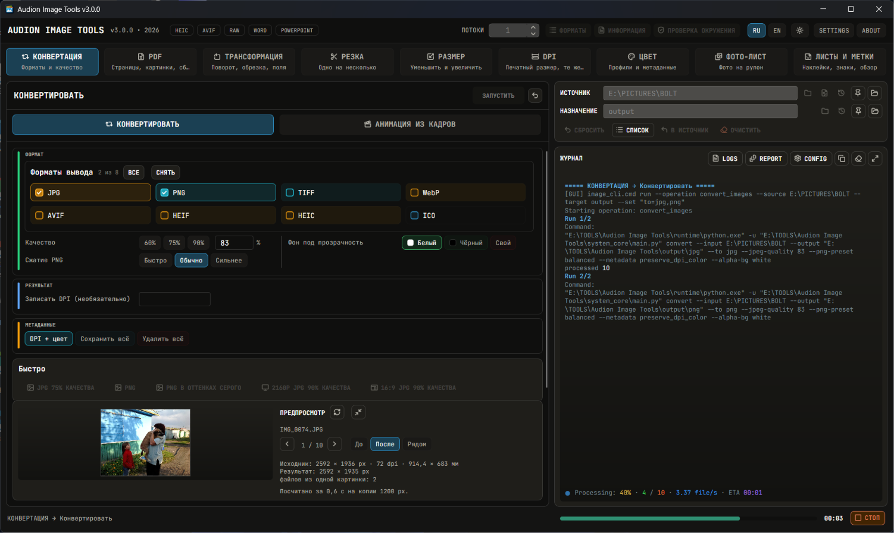

# Audion Image Tools

<!-- audion:release -->
<p align="center">
  <a href="https://audion.dev/downloads/image-tools"></a>
  <a href="https://github.com/Tensionix/image-tools/releases/latest"></a>
  <a href="https://github.com/Tensionix/image-tools/releases"></a>
  <a href="https://github.com/Tensionix/image-tools/blob/main/LICENSE"></a>
</p>

**Version 3.0.1** · 2026-10-29 · 216.9 MB

- [Direct download](https://dl.audion.dev/image-tools/3.0.1/Audion_Image_Tools_v3.0.1_Full.zip) — unmetered, no rate limits
- [Project page](https://audion.dev/downloads/image-tools) — every version and how to install
- [GitHub release](https://github.com/Tensionix/image-tools/releases/tag/v3.0.1)

<p align="center"></p>

`SHA-256: 25a3b115e24fae99f93894ae44d0e8957fde39e2b4a0e8dcc66a0930f4ca3fa0`

---

An **Audion** tool, published by [Tensionix](https://github.com/Tensionix).
<!-- /audion:release -->


[English README](docs/README_EN.md) · [User Guide](docs/USER_GUIDE_EN.md) | [Русский README](docs/README_RU.md) · [Руководство](docs/USER_GUIDE_RU.md)

**Contents**

- [Why It Exists](#why-it-exists)
- [Principles](#principles)
- [What It Can Do](#what-it-can-do)
- [Next](#next)
- [Technical Reference](#technical-reference)
  - [Running](#running)
  - [Defaults](#defaults)
  - [Choosing a Colour Profile](#choosing-a-colour-profile)
  - [Folders](#folders)
  - [Source and Target](#source-and-target)

A portable toolkit for images: conversion, colour, sizing, cropping, watermarks,
tiling, contact sheets - and PDF pages and the pictures inside DOCX, PPTX and PDF.

## Why It Exists

Working with images splits into two different jobs, and confusing them is
expensive.

The first is **accept whatever you were given**. A shoot arrives as camera RAW, a
scan as a multi-frame TIFF, a layout as PSD, a phone photo as HEIC. The program
has to open all of it without asking where it came from.

The second is **deliver predictably**. Here the opposite matters: a narrow set of
formats where behaviour is worked out in detail — what happens to transparency,
how the colour profile is written, whether pixels change at all.

Hence the central decision: **wide on the way in, narrow on the way out**. On
input, everything that can be opened. The deep, predictable processing is
concentrated around JPG and PNG.

## Principles

**Three levels of format support are named aloud.** Not "supported", but how
well.

| level | what it means | formats |
|---|---|---|
| stable core | worked out, always works | BMP, GIF, JPG, PNG, TGA, TIFF, WebP, AVIF |
| via adapter | needs an extra layer | HEIC and HEIF, camera RAW — CR2, CR3, DNG |
| best effort | does not always open | WMF, IFF, XIF; PSD as far as it goes |

What is available on a particular machine, the program says itself:

```bat
python system_core\main.py formats
```

**Colour is chosen, not guessed.** sRGB for screens, CMYK for print — and in each
case explicitly: the built-in path with no external file, or a specific profile
from disk. The program will not decide which of the two CMYK profiles you need,
because that depends on the print shop, not on the file.

**Operations that leave pixels alone are kept apart from those that don't.**
Writing resolution changes only the tag in the file; fitting to a roll
recalculates resolution from a size in millimetres while leaving the pixels as
they are. This is stated at each such operation, so you don't later hunt for
where the quality loss came from.

**Compatibility beats compactness.** WebP, AVIF, and HEIF are there for light
delivery, but JPG remains the one that opens everywhere, and the program will not
replace it with them by default.

## What It Can Do

| area | about |
|---|---|
| Conversion | to JPG, PNG, TIFF, WebP, AVIF, HEIF, HEIC; quality by preset or exact value |
| Colour | normalisation with an explicit profile, greyscale, safe transparency handling for JPG |
| Sizing | to 1080p, 1440p, 2160p screens; to 16:9, A4, A3; to a roll by a side in millimetres |
| Resolution | writing a chosen resolution without touching pixels |
| Cropping | a solid border, smart white-background crop, a safety margin in millimetres |
| PDF assembly | straight after cropping, with embedded PNG or JPG |
| Watermark | a caption in the corner or a diagonal protective line, with adjustable opacity and colour |
| Tiling | one image across A5, A4, A3, or a roll — for stickers, with margins and gaps in millimetres |
| Contact sheet | a grid of thumbnails: standard sizes or your own |
| Frames | a multi-frame picture (TIFF, GIF, WebP, APNG) into numbered PNG frames with their pauses; frames back into GIF, WebP or APNG |
| Rotation | fixing by the orientation tag; a JPEG turned by 90, 180, 270 degrees without loss (jpegtran) |
| Exact size | fit, pad, crop or stretch to a size in pixels; a scale of 0.1 to 1000 % |
| Correction | levels, brightness, contrast, gamma, saturation, grey, sepia, a tint, inverse, white to transparent; PNG of 256 colours |
| Metadata | EXIF and GPS taken out without writing the picture again, its pixels checked |
| ICO | every size Windows asks for, in one file |
| PDF pages | turn chosen pages, merge, split by ranges, clear the metadata; every copy checked before it is called done |
| Pictures in documents | DOCX, PPTX, PDF: check their DPI, raise them, shrink them, fit a document under a size in MB, sRGB or CMYK, take them out; a small PNG - a coat of arms, a sign - stays PNG |
| Preview | before, after, side by side - for the operations that are hard to set blind |

PDF files and the pictures inside documents are read and written by the PyMuPDF
library, which is distributed under the GNU AGPL 3.0. The program's own code
stays under Apache 2.0, but the build as a whole — the program together with
PyMuPDF — is offered under the terms of the GNU AGPL 3.0; see the `NOTICE` file.

## Next

* [User Guide](docs/USER_GUIDE_EN.md) — step by step.
* `install\README_INSTALL.md` — building the environment and the window.

---

## Technical Reference

### Running

```cmd
Start.exe                 the window
image_cli.cmd describe    every section, operation and field as JSON
image_cli.cmd run --operation downscale_percent --set scale_mode=custom --set custom_percent=75
```

The window is a native Windows window (`App\`). A button of the window does
nothing the console cannot: it runs `image_cli.cmd` with the same settings, and
the journal writes that line at every start. Exit codes: `0` done, `1` failed,
`130` stopped, `2` a wrong call - and then nothing is run.

The journal shows a batch of many files as one live line: the share done, how
many are done and how many there are, the speed, the time left and the file -
each in its own colour. A file that went wrong stays in the journal as a line;
every line of every file is in the log of the operation in `logs\`.

### Defaults

| what | value |
|---|---|
| JPG quality | 83; presets 60, 75, 90; exact values 1 to 100 |
| PNG compression | one preset in the window, a parameter on the command line |
| contact sheet quality | 75 or 92 |
| diagonal caption | about 60 % of the diagonal |

### Choosing a Colour Profile

| task | what to pick |
|---|---|
| screen, website, ordinary delivery | sRGB |
| print | CMYK |
| built-in path without an external file | Pillow sRGB |
| an explicit external reference | the color.org profile |
| broad classic print scenario | `Photoshop5DefaultCMYK.icc` |
| coated print to a specific standard | `CoatedFOGRA39.icc` |

### Folders

```
App\          the window and the PowerShell the program carries
Start.exe     opens the window
input\        quick source folder
output\       results
logs\         the log of every operation, run reports
report\       the reports of checks
workspace\    temporary area
config\       the operations, the layout of the window, defaults, ICC profiles
system_core\  the engine and the console command
install\      portable environment
wheelhouse\   packages for offline install
```

### Source and Target

**SOURCE** and **TARGET** are the two working paths, each with its history and
its pins; SOURCE may be a single file. Under them: **RESET** returns both to the
project `input` and `output` (the history is cleared, the pins stay, no file is
touched); **LIST** writes into the journal what lies in SOURCE; **TO SOURCE**
makes the result the source of the next operation; **CLEAR** deletes the
contents of SOURCE, TARGET or both - into the Recycle Bin, after a question that
names the paths. In Russian: **ИСТОЧНИК**, **НАЗНАЧЕНИЕ**, **СБРОСИТЬ**,
**СПИСОК**, **В ИСТОЧНИК**, **ОЧИСТИТЬ**.
